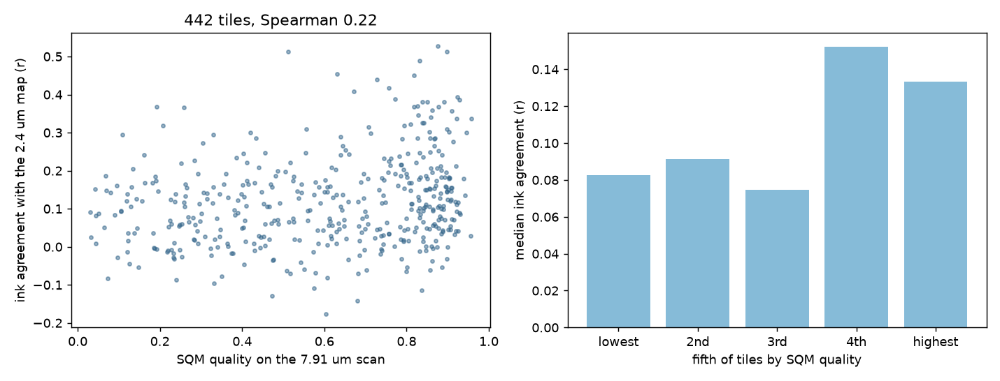

# Scan Quality Map (SQM)

SQM shows where a Herculaneum scroll CT scan can still separate the papyrus layers, and where haze hides them. It scores small blocks of a scan from 0 (hazy) to 1 (clear) and writes the result as an OME-Zarr map, as an extra channel on a tifxyz segment, or as an image you can lay over a segment render.

It is built for scans in the 8 to 9.4 um range. All 22 scrolls still eligible for a First Letters prize have a scan at 8.64 or 9.362 um, 20 of them have nothing finer, and the First Letters prize for PHerc. 343 (October 2026) was won on an 8.64 um scan.

## What it answers

Before tracing a sheet or running ink detection on a region, it helps to know whether the scan resolves the layers there at all. In compressed regions, carbonized fibres scatter the beam and neighbouring sheets blur into one band. SQM measures that directly from the scan, so you can pick clear regions first and treat results from hazy ones with care.

## Install

Python 3.11 or newer.

```
pip install git+https://github.com/jcooperkai-sys/Scan-Quality-Map
```

Data is streamed from the public OME-Zarr volumes, so nothing large is downloaded up front. A chunk cache lives under `SQM_CACHE` (default `~/.cache/sqm`) and is capped by `SQM_CACHE_GB` (default 5).

## Quick start

Score a segment. This writes a copy of the tifxyz folder with an added `quality.tif` channel, a flat preview `quality.png`, per patch numbers in `quality_patches.json`, and with `--overlay` a transparent `quality_overlay.png` at the size of the segment renders.

```
sqm segment \
  --mesh https://raw.githubusercontent.com/Nieuwlaar/pherc343-first-letters/HEAD/outputs/concat_w047-w048_R5B2_z9500-11000.tifxyz \
  --volume https://vesuvius-challenge-open-data.s3.us-east-1.amazonaws.com/PHerc0343/volumes/20250521140437-8.640um-1.2m-116keV-masked.zarr \
  --voxel-um 8.64 --level 0 --block 96 --patch 16 --overlay --out pherc343_letters_quality
```

Map a region of a scroll. This writes `quality.zarr` (OME-Zarr, scale and translation in level 0 voxels so it lines up with the source volume), one PNG per slice, and `blocks.json` with every measurement.

```
sqm map \
  --volume https://vesuvius-challenge-open-data.s3.us-east-1.amazonaws.com/PHerc0343/volumes/20250521140437-8.640um-1.2m-116keV-masked.zarr \
  --voxel-um 8.64 --level 0 --block 96 --step 384 --region 9472:11008,0:8595,0:8595 --out pherc343_band
```

Use a step that is a multiple of the volume's chunk size. Each block then reads a single chunk, which keeps network use low.

Compare marked regions of a segment, or rank a mesh against a map:

```
sqm regions --segment pherc343_letters_quality --patch 16 --boxes letter_boxes.json
sqm regions --map pherc343_band/blocks.json --mesh <tifxyz folder or URL>
```

Run `sqm` with no arguments to list every command, and `sqm <command> --help` for its options.

## How the score works

Each block (96 voxels across, about 0.8 mm at 8 um) is measured three ways. All three are classical image measurements with no trained network, and their parameters are set in micrometres so they carry across voxel sizes.

1. Sheet coherence: from the structure tensor, how strongly the local texture lines up as flat sheets.
2. Contrast: how cleanly the brightness splits into two groups, papyrus and gap (the share of variance explained by the best two class split).
3. Dark fraction: the share of voxels well below the block's median brightness, so how much open gap between sheets is still visible.

A logistic model combines them into one quality value. Its weights and standardisation are in `sqm/model.json`.

Blocks that look like the packing foam or support material around a scroll (contrast of at least 0.86 together with valley depth of at most 0.15, where valley depth measures how deep the gaps between neighbouring layers are) are marked as not papyrus and left out of maps, atlas and targets. On the 934 papyrus blocks measured for validation, this rule flags at most 0.8% of any one set.

## Validation

Every number below comes from the scripts in this repository (see Reproduce). I split the data before fitting anything and evaluated each held out set once.

### Two scans of the same papyrus

PHerc. Paris 4 was scanned at 7.91 um (Diamond Light Source, 2023) and at 2.4 um (ESRF, 2026). With the official transform from the Vesuvius Challenge catalogue (median landmark residual 1.5 voxels), I cut 40 spots from the 7.91 um scan and resampled the 2.4 um scan onto exactly the same voxels. On the 34 spots not used during development, the quality score rated the clearer 2026 scan higher at 34 of 34.

### Hidden sheets in a 7.91 um scan

In 400 blocks of the Paris 4 Grand Prize region, I counted the real sheets along 49 lines per block from the 2.4 um hand labels and compared that with how many separate sheets the 7.91 um scan shows along the same physical lines. The 2.4 um scan itself shows 99 to 100% of the labelled sheets. The 7.91 um scan shows a median of 93%, and 78% at the 10th percentile. I fitted the model on the lower half of the region by height and tested it once on the upper half:

| Held out test | Result |
|---|---|
| Finding the worst quarter of blocks (AUC) | 0.73 (95% CI 0.63 to 0.82) |
| Sheets visible in the fifth of blocks SQM rates lowest | 87% |
| Sheets visible in the fifth of blocks SQM rates highest | 95% |

### Scrolls the model never saw

I applied the frozen model unchanged to two more scrolls that have hand labels and a lower resolution scan. Their label sets mark only some sheets, so I kept only blocks whose labels look complete, using a rule fixed on Paris 4 beforehand.

| Scroll | Low resolution scan | Blocks | AUC, worst quarter |
|---|---|---|---|
| PHerc. 1667 | 7.91 um | 144 | 0.62 (95% CI 0.51 to 0.72) |
| PHerc. 0343P | 8.64 um | 153 | 0.63 (95% CI 0.53 to 0.74) |

Both scans resolve almost all of the labelled sheets (medians near 100%), because annotators tend to label where the papyrus is clear. That leaves little haze to find in these tests, so they are weaker than the Paris 4 test.

### Does a low score mean ink detection fails there?

The tests above check sheets. This one checks ink. The Vesuvius Challenge team fitted a spiral segment through the whole of Paris 4 in the 2.4 um scan and ran ink detection on it (`PHercParis4/segments/20260926044226-spiral-output-generation-19`). I moved that segment into the 7.91 um scan with the catalogue transform, cut 14 crops spread evenly from the outer to the inner windings, rendered each one from the 7.91 um scan, and ran the 2023 Grand Prize ink model on the renders (`scrollprize/timesformer_GP_scroll1`, Youssef Nader, MIT). For every tile of about 6.7 by 6.7 mm, I correlated that ink map with the 2.4 um ink map and compared the result with the SQM score of the same tile. The measure, tile rules and statistics were fixed before the first result: tiles need at least half their area covered by the reference and at least 5% of it marked as ink, and confidence intervals resample whole crops.



| 442 tiles in 14 crops | Grand Prize model |
|---|---|
| Spearman, SQM quality against ink agreement | 0.22 (95% CI 0.06 to 0.37) |
| Finding the worst third of tiles by agreement (AUC) | 0.58 (95% CI 0.51 to 0.68) |
| Median agreement in the fifth of tiles SQM rates lowest | 0.08 |
| Median agreement in the fifth of tiles SQM rates highest | 0.13 |
| Spearman within crops (each crop centred) | 0.18 (95% CI 0.07 to 0.28), positive in 9 of 12 crops |
| Spearman between crop medians | 0.06 |

The effect is modest and it is local. Inside one crop, tiles that SQM rates lower agree less with the 2.4 um ink, but the median score of a crop says almost nothing about its median agreement. Use the map to find where ink detection will be weakest within a region, not to rank distant regions against each other.

The result holds up under a few changes I tried after the fact: shifting the reference by the 2 to 3 pixel offset I measured between the two maps (Spearman 0.17), and smoothing both maps to letter scale (0.21 at 1.5 pixels, 0.21 at 3 pixels). Smoothing raises the agreement itself from 0.11 to 0.23 but not the link with the score.

Where the score is wrong:

- Crops c09 and c10 (windings 75 to 76 and 66) have some of the highest scores of the test (median 0.83) but low agreement (0.07 and 0.09). The layers there look clean, so SQM rates them well, yet the ink model finds little. Crop c12, scored about the same, has the best agreement (0.29). Something other than scan clarity limits ink detection in c09 and c10, and SQM cannot see it.
- In 3 of 12 crops (c02, c11, c12) the score runs the wrong way within the crop (Spearman about minus 0.2). Two of them have a narrow range of scores (0.5 to 0.9), where small differences in quality matter less than the text itself.
- Agreement is low everywhere (median r 0.11): the 7.91 um scan is hard for ink detection, and the 2.4 um map is itself a model prediction, not ground truth.
- The first ink model I tried, reader v3 (`domenicor046/reader-v3`), does not transfer to this scan and finds blobs even in the clearest crops. With it, the pooled Spearman is 0.06 (95% CI minus 0.07 to 0.21), although within crops it is still 0.15 (95% CI 0.05 to 0.24). How much SQM can tell you about ink depends on whether the ink model works on that scan at all.

Reproduce on a GPU machine with VC3D: `pip install .[ink]`, then `scripts/paris4_ink.sh` (set `MODEL=reader3` for the reader v3 run, which needs villa `vesuvius` instead).

## Atlas of the First Letters scrolls

`sqm atlas` mapped all 22 scrolls still eligible for a First Letters prize on a coarse grid (one block every 6.6 mm, about 12,500 blocks in total). The table ranks scrolls within each scan protocol and gives the height band where each scroll's scan is clearest. Height profiles for every scroll: `docs/atlas_profiles.png`. Raw numbers: `docs/atlas.json`.

Compare scrolls only within the same scan protocol. Across protocols, scores also reflect scan settings.

| Scan protocol | Scroll | Blocks | Median quality | Clear (>= 0.6) | Hazy (< 0.4) | Clearest band (z) | Its median |
|---|---|---|---|---|---|---|---|
| 8.64 um, 116 keV | PHerc0175A | 552 | 0.50 | 36% | 38% | 7680 | 0.63 |
| 8.64 um, 116 keV | PHerc0343 | 699 | 0.34 | 24% | 56% | 12288 | 0.55 |
| 8.64 um, 116 keV | PHerc0483B | 482 | 0.30 | 12% | 63% | 9984 | 0.45 |
| 8.64 um, 116 keV | PHerc0306B | 615 | 0.30 | 15% | 63% | 9216 | 0.42 |
| 8.64 um, 116 keV | PHerc0800 | 1331 | 0.28 | 14% | 65% | 3072 | 0.49 |
| 8.64 um, 116 keV | PHerc0175B | 971 | 0.27 | 15% | 65% | 14592 | 0.55 |
| 8.64 um, 116 keV | PHerc0483A | 530 | 0.18 | 9% | 76% | 13056 | 0.35 |
| 8.64 um, 116 keV | PHerc1218 | 507 | 0.17 | 11% | 74% | 7680 | 0.46 |
| 8.64 um, 116 keV | PHerc0490A | 626 | 0.16 | 9% | 75% | 5376 | 0.35 |
| 8.64 um, 116 keV | PHerc0490B | 417 | 0.11 | 4% | 86% | 2304 | 0.24 |
| 8.64 um, 116 keV | PHerc0268 | 1434 | 0.08 | 3% | 88% | 13056 | 0.19 |
| 9.362 um, 113 keV | PHerc0358 | 460 | 0.57 | 47% | 35% | 9216 | 0.73 |
| 9.362 um, 113 keV | PHerc0813 | 543 | 0.53 | 44% | 39% | 12288 | 0.66 |
| 9.362 um, 113 keV | PHerc0826 | 402 | 0.44 | 30% | 46% | 9216 | 0.70 |
| 9.362 um, 113 keV | PHerc0191 | 726 | 0.41 | 30% | 48% | 11520 | 0.54 |
| 9.362 um, 113 keV | PHerc0211 | 484 | 0.38 | 27% | 52% | 9216 | 0.66 |
| 9.362 um, 113 keV | PHerc1203 | 502 | 0.35 | 19% | 56% | 11520 | 0.50 |
| 9.362 um, 113 keV | PHerc1545 | 445 | 0.31 | 24% | 57% | 15360 | 0.56 |
| 9.362 um, 113 keV | PHerc0846B | 381 | 0.25 | 17% | 64% | 11520 | 0.48 |
| 9.362 um, 113 keV | PHerc0846A | 393 | 0.18 | 15% | 69% | 3072 | 0.60 |
| 9.362 um, 113 keV | PHerc0257 | 495 | 0.14 | 7% | 81% | 13056 | 0.28 |
| 9.362 um, 113 keV | PHerc0125 | 643 | 0.12 | 5% | 86% | 18432 | 0.25 |

Among the 8.64 um scrolls, PHerc. 0343, where the first letters were read in October 2026, ranks second of eleven.

### Where to start in each scroll

`sqm targets` maps each scroll's clearest band on a finer grid (one block every 3.3 mm) and lists its clearest regions, at least 1536 voxels apart, away from the scroll's outer edge. I checked every first pick by eye to confirm it is papyrus. Full list with five regions per scroll: `docs/targets.json`.

Coordinates are level 0 voxels of the listed volume, as x, y, z (the order VC3D shows).

| Scroll | Scan protocol | Band median | Region 1 (x, y, z) | Q | Region 2 (x, y, z) | Q | Region 3 (x, y, z) | Q |
|---|---|---|---|---|---|---|---|---|
| PHerc0175A | 8.64 um, 116 keV | 0.60 | 5424, 5808, 6960 | 0.93 | 3120, 5808, 7728 | 0.93 | 4272, 4656, 7728 | 0.93 |
| PHerc0343 | 8.64 um, 116 keV | 0.54 | 5808, 3504, 11952 | 0.91 | 3888, 3120, 13104 | 0.89 | 1968, 4272, 12336 | 0.86 |
| PHerc0800 | 8.64 um, 116 keV | 0.44 | 3504, 3120, 2736 | 0.89 | 6960, 5808, 3504 | 0.88 | 2736, 3888, 3888 | 0.88 |
| PHerc0483B | 8.64 um, 116 keV | 0.39 | 4272, 4656, 10800 | 0.89 | 5808, 3888, 10800 | 0.87 | 1968, 5424, 9264 | 0.81 |
| PHerc0306B | 8.64 um, 116 keV | 0.35 | 4656, 4272, 9648 | 0.91 | 2352, 4656, 8496 | 0.85 | 3120, 3120, 9264 | 0.79 |
| PHerc0175B | 8.64 um, 116 keV | 0.32 | 5040, 4656, 13872 | 0.84 | 2352, 2352, 14256 | 0.80 | 1968, 3888, 14256 | 0.70 |
| PHerc0483A | 8.64 um, 116 keV | 0.32 | 3120, 5808, 13488 | 0.85 | 3888, 4656, 12720 | 0.85 | 6576, 4272, 12720 | 0.83 |
| PHerc0490A | 8.64 um, 116 keV | 0.30 | 2352, 4272, 6192 | 0.94 | 3504, 3120, 6192 | 0.90 | 5808, 3120, 5040 | 0.87 |
| PHerc1218 | 8.64 um, 116 keV | 0.23 | 3504, 3888, 7344 | 0.92 | 2352, 3504, 8496 | 0.81 | 5040, 3504, 7728 | 0.79 |
| PHerc0490B | 8.64 um, 116 keV | 0.20 | 3888, 3504, 2352 | 0.83 | 6192, 2736, 2352 | 0.68 | 5040, 5040, 1968 | 0.63 |
| PHerc0268 | 8.64 um, 116 keV | 0.15 | 4272, 10032, 12720 | 0.79 | 2352, 9264, 12336 | 0.73 | 3504, 8496, 13104 | 0.59 |
| PHerc0358 | 9.362 um, 113 keV | 0.66 | 3504, 3504, 9648 | 0.95 | 4272, 4272, 8496 | 0.95 | 1584, 2352, 10032 | 0.93 |
| PHerc0826 | 9.362 um, 113 keV | 0.65 | 5808, 4656, 8496 | 0.94 | 1584, 4656, 10032 | 0.94 | 4656, 5808, 9648 | 0.93 |
| PHerc0813 | 9.362 um, 113 keV | 0.62 | 3504, 1968, 13104 | 0.95 | 2736, 3504, 13104 | 0.94 | 5424, 4656, 12336 | 0.92 |
| PHerc0846A | 9.362 um, 113 keV | 0.51 | 5808, 3504, 3504 | 0.91 | 2736, 2352, 3888 | 0.89 | 4272, 2352, 3888 | 0.87 |
| PHerc1203 | 9.362 um, 113 keV | 0.50 | 2736, 3120, 12720 | 0.92 | 5040, 3888, 12336 | 0.90 | 4272, 2352, 12720 | 0.88 |
| PHerc0211 | 9.362 um, 113 keV | 0.43 | 3888, 3504, 10032 | 0.93 | 3504, 3888, 8496 | 0.90 | 1968, 2736, 10032 | 0.86 |
| PHerc0191 | 9.362 um, 113 keV | 0.42 | 4656, 4656, 11952 | 0.91 | 2736, 2736, 11184 | 0.87 | 5424, 5424, 10800 | 0.86 |
| PHerc0846B | 9.362 um, 113 keV | 0.36 | 5808, 3504, 11952 | 0.88 | 3504, 4272, 11184 | 0.87 | 1200, 3504, 12336 | 0.87 |
| PHerc1545 | 9.362 um, 113 keV | 0.32 | 3888, 4656, 15408 | 0.87 | 1968, 3504, 16176 | 0.86 | 5424, 5424, 14640 | 0.82 |
| PHerc0257 | 9.362 um, 113 keV | 0.23 | 5040, 5808, 13488 | 0.79 | 4272, 4272, 12720 | 0.78 | 4656, 2736, 12720 | 0.72 |
| PHerc0125 | 9.362 um, 113 keV | 0.21 | 5040, 2736, 18864 | 0.79 | 6576, 5040, 18096 | 0.75 | 5808, 3504, 17712 | 0.68 |

### Case note: PHerc. 0826

In August 2026, Lutfiya Miller and Chris Müller ran the published First Letters workflow on PHerc. 0826, slices 10,000 to 11,000, and reported no ink in that window (github.com/millerandmuller/first-light-pherc0826). In the atlas map of PHerc. 0826, that window has a median quality of 0.63, at the 73rd percentile of the scroll and next to its clearest band (z 9216 to 9984, median 0.70). The scan resolves the layers there about as well as anywhere in this scroll, so scan quality was probably not what limited that attempt.

## Limits

- SQM measures whether the scan resolves the layers. Inside the 2.4 um Paris 4 scan it does not predict where surface prediction models disagree with hand labels: held out AUC 0.53 for the recto model and 0.54 for the m7 model, which is chance level.
- On the 7.91 um Paris 4 scan, lower scores go with weaker ink detection inside a region (within crop Spearman 0.18), but the score does not rank regions far apart by how well ink detection will work there.
- I fitted the model on one scan (Paris 4 at 7.91 um). On very different scanners or energies, read the scores as a ranking within that scan.
- On the PHerc. 343 First Letters segment, patches with letters score a median of 0.69 against 0.64 for the rest of the segment, and the segment's blocks in the band map score a median of 0.63 against 0.51 for the whole band. This is one example, picked after the fact, so treat it as an illustration.
- Block size sets the resolution of the map, about 0.8 mm per block. The atlas uses a coarser grid (6.6 mm) to cover whole scrolls.

## Reproduce

`python scripts/reproduce.py` runs every step in order and writes all results and figures to one folder. The heavy parts stream data and run on CPU. Tests: `pip install .[test]` then `pytest tests`.

## Formats

- Input volumes: OME-Zarr (zarr v2, uncompressed or Blosc, `.` or `/` chunk keys), local or over HTTPS.
- Input segments: tifxyz folders (`x.tif`, `y.tif`, `z.tif`, `meta.json`), local or over HTTPS.
- Output: OME-Zarr quality grid, tifxyz with a `quality.tif` channel, PNG previews, JSON with every measurement.

## Data

Data from the EduceLab Scrolls dataset, via the Vesuvius Challenge: Parsons, S., Parker, C. S., Chapman, C., Hayashida, M., and Seales, W. B. (2023). EduceLab Scrolls: Verifiable Recovery of Text from Herculaneum Papyri using X ray CT. arXiv:2304.02084. Data used in this work were obtained from the EduceLab Scrolls dataset. No scan data is included in this repository.

The ink test uses the Paris 4 spiral segment and its 2.4 um ink map published by the Vesuvius Challenge, the 2023 Grand Prize TimeSformer ink model by Youssef Nader (huggingface.co/scrollprize/timesformer_GP_scroll1, MIT) and reader v3 (huggingface.co/domenicor046/reader-v3, MIT). Renders use VC3D from ScrollPrize/villa. Weights are downloaded and checked by SHA256, never stored here.

The PHerc. 343 example uses the published First Letters segment by Erwin Nieuwlaar (github.com/Nieuwlaar/pherc343-first-letters, MIT).

## License

MIT
